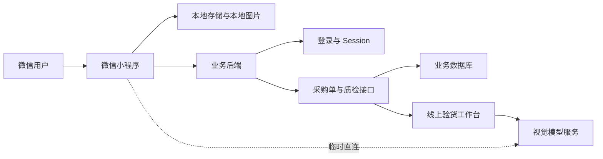

# 智能质检报告微信小程序

面向工业检验报告的微信小程序客户端。小程序通过业务后端完成账号认证、质检订单待检任务读取、独立报告创建、质检草稿保存和历史记录同步；当前识别功能临时直连视觉模型服务，客户端负责图片队列、结果校对、本地容错及 JSON 导出。

## 核心能力

- 账号登录和 Session Cookie 复用，未登录或会话失效时自动返回登录页。
- 拍照或从相册批量添加检验报告，最多 10 个未完成任务。
- 识别任务按加入顺序逐张处理，识别期间仍可继续添加图片。
- 图片按原始文件上传，客户端不再设置图片大小上限或强制压缩。
- 当前临时直接调用可配置的视觉模型接口处理 JPEG、PNG 图片；模型令牌只从微信本地存储读取，不硬编码进仓库。
- 将 OCR 结果归一化为可编辑的十样本检验表格。
- 结合模型置信度与确定性格式检查，显示红色“重点核对”和黄色“建议核对”提示。
- 支持钢丝刷、拉绒片、树脂砂轮、百叶轮、网格砂和金刚石锯片等报告类型。
- 读取待检质检订单，以质检单号展示任务，同时保留采购合同、客户、供应商和产品信息，并将审核后的检验草稿回写数据库。
- 待检工作台将质检单原图和现场验货图片分开保存；现场验货图片上传到线上验货识别区域后，由线上工作台自动识别，小程序同步展示线上返回的图片归类和检测数据。
- 独立报告使用稳定客户端 UUID 幂等创建，网络失败后可安全重试。
- 合并本地记录与服务器历史记录，支持重新打开、编辑、同步和失败重试。
- 将检验结果导出为 `inspection-table/v1` JSON 文件并通过微信文件分享。
- 使用统一设计令牌、毛玻璃底部导航、卡片阶梯入场动画和安全区适配。

## 页面与业务流程

### 1. 登录

1. 用户输入智能销售系统账号和密码。
2. 小程序请求后端登录接口。
3. 后端返回 Session Cookie，小程序保存 Cookie 并用于后续请求。
4. 再次启动时，小程序通过当前用户接口验证会话；收到 `401` 时清除本地 Cookie 并返回登录页。

### 2. 连续识别

1. 在“检验报告识别”页拍照，或从相册批量添加图片。
2. 图片进入本地识别队列，依次经历等待、图片处理、识别、待审核或失败状态。
3. 用户可在后台识别期间继续添加报告，也可跳过、删除或重试任务。
4. 识别完成后进入审核页面，核对报告信息、检验项目、十个样本值和判定结果。
5. 保存时先写入本地历史，再同步至业务后端；同步失败不会丢失本地记录。

### 3. 质检订单

1. 待检列表以质检订单为主；首次进入待检页时加载一次，之后切换页签或返回页面不会自动刷新。产品草稿保存成功后，在后台合并短时间内的连续保存事件，再读取所属质检订单的 `compact=true` 线上快照；同一时间最多进行一次回读，让该订单内各产品的最新检测摘要和图片异步回显。其他线上变更仍通过列表下拉刷新同步。下拉图标的透明度和位移由 WXS 在视图层直接跟随手势，不经过逻辑层 `setData`；只有到达刷新阈值后才旋转，光晕保持柔和呼吸效果。导航栏高度确认前不启用下拉；如果首次列表请求尚未完成就触发下拉，刷新状态会复用该请求并在其结束后强制回收，避免高度抖动或一直停在刷新中。刷新结果会先与当前列表比较，没有变化时不调用 `setData` 更新列表，也不会丢失已上拉加载的后续分页。列表和订单展开使用紧凑载荷，只返回检测摘要、照片总数、最多 3 张原图引用及对应的 320px 缓存缩略图地址；卡片只在缩略图进入可视区域后下载小图，点击缩略图时才通过 `wx.previewImage` 加载原图，完整草稿和全部图片仅在进入具体产品检验工作台时读取。
2. 订单卡片以质检单号为标题，采购合同号作为关联信息展示；可按质检单号、采购合同、客户或供应商搜索。
3. 展开质检订单并选择具体待检产品，客户、供应商、物料、规格、数量和日期等线上信息会预填到检验工作台。
4. 图片识别出的合同号只与质检订单的采购合同号匹配，不会拿质检单号或来源审核号冒充合同号。
5. 同一采购合同存在多个质检订单时，继续结合产品和规格唯一匹配；无法唯一确定时保留本地记录并提示人工处理。
6. 质检单原图保存到 `record_source_images`，用于尺寸、安全性能等质检单识别与来源追溯。
7. 现场验货图片上传后保存到 `ai_workbench_images`，同时写入 `visual_recognition_request.status = pending`。
8. 小程序不调用验货图片 AI 识别接口，也不在本地推断分类；线上 React 验货工作台恢复待处理图片后自动触发识别，并将 `image_assignments`、`measurements` 等结果写回 `ai_workbench_result`。
9. 小程序重新读取产品草稿后，按与线上工作台一致的项目语义，把 `image_assignments` 对应图片和 `measurements` 检测值合并到各检验条目的“现场照片”和“实测值”区域；第一页不再集中展示验货图片缩略图，待处理状态仅保留文字提示。
10. 识别并审核报告后，结果保存到对应质检订单和产品明细的质检草稿中。

### 4. 识别记录

- 同时显示本地记录和服务器历史记录。
- 已同步的本地副本会按服务端任务与明细编号去重。
- 本地记录可查看图片、原始识别内容、同步状态和失败原因。
- 同步失败的记录可点击“重试同步”。
- 删除本地副本不会删除已经同步到服务器的记录。

## 系统架构



业务接口与大模型识别地址已分开配置。由于线上识别代理尚未提供，当前小程序临时直接调用视觉模型服务；识别代理上线后应恢复由 HTTPS 业务后端代理模型调用，避免长期在小程序侧保存模型访问配置。

待检工作台中的现场验货图片采用不同链路：小程序只负责选择、压缩、上传和保存，不提交验货 AI 识别，也不根据文件名或检验项目自行猜测分类；线上 React 工作台读取 `ai_workbench_images` 和待处理标记后自动调用验货识别，并把 `image_assignments`、`measurements` 等结果写回共享草稿。小程序再次加载草稿时直接把这份线上归类图片与检测值合并到对应检验条目，图片只在条目后的“现场照片”区域展示。质检单识别原图始终单独保存在 `record_source_images`，不得与现场验货图片混用。

## 技术栈

- 微信小程序
- TypeScript `^5.5.4`
- WXML
- SCSS
- glass-easel 组件框架
- 微信小程序基础库 `2.32.3`
- Node.js 测试运行器
- `tsx`
- `miniprogram-api-typings`

## 项目结构

```text
miniprogram/
  app.json                         页面、网络超时和运行时配置
  config/
    server.ts                      后端地址、请求超时和 Session 存储键
  domain/
    inspection-record.ts          OCR 数据归一化、日期校验和表格编辑
    inspection-history.ts         本地历史、迁移、同步状态和数量限制
    inspection-export.ts          inspection-table/v1 导出契约
    recognition-queue.ts          连续识别队列及状态转换
    recognition-review.ts         置信度归一化和红黄审核提示
  services/
    auth-service.ts               登录、当前用户和退出
    server-client.ts              JSON 请求、文件上传、Cookie 和错误映射
    inspection-service.ts         图片上传准备和识别结果归一化
    quality-inspection-service.ts 质检订单、独立报告、草稿和历史接口
    history-service.ts            本地存储及持久图片管理
    export-service.ts             JSON 文件生成和微信文件分享
  pages/
    login/                         账号登录页
    index/                         识别队列、审核、质检订单和历史记录
    logs/                          小程序模板日志页
  styles/
    _design-tokens.scss            登录页和工作区共享设计令牌
tests/
  *.test.ts                        领域逻辑、服务、API 契约和 UI 文档测试
docs/superpowers/
  specs/                           已确认的功能设计
  plans/                           对应实施计划
```

## 环境要求

- 微信开发者工具。
- Node.js 18 或更高版本（推荐）。
- npm。
- 一个正在运行、并实现本文接口约定的统一业务后端。
- 真机测试时，需要手机能够访问后端地址。

## 安装

```bash
npm install
```

## 服务配置

业务服务配置位于：

```text
miniprogram/config/server.ts
```

当前配置：

```ts
export const DATA_SERVER_BASE_URL = 'https://www.binictools.cn:7876'
export const RECOGNITION_API_URL = 'https://www.binictools.cn:7876/api/miniprogram/quality-inspections/recognize'
```

- `DATA_SERVER_BASE_URL` 用于登录、待检任务、质检记录、草稿和业务图片等数据读写。
- `RECOGNITION_API_URL` 是完整的检验报告识别接口地址，可独立切换识别服务。
- 识别请求通过业务后端代理：`POST /api/miniprogram/quality-inspections/recognize`，小程序使用 `wx.uploadFile` 上传压缩后的报告图片。
- 小程序不保存模型地址或模型令牌；模型服务地址、模型名称和凭据只由业务后端管理。

同一文件还定义请求超时、上传/识别超时、Session Cookie 存储键和演示模式。

> 当前线上业务地址使用 HTTPS，可供真机和体验版访问。微信公众平台仍需将 `https://www.binictools.cn:7876` 配置为 request 与 uploadFile 合法域名。

## 在微信开发者工具中运行

1. 安装依赖：`npm install`。
2. 打开微信开发者工具，选择“导入项目”。
3. 选择仓库根目录。
4. 确认小程序源码目录为 `miniprogram/`。
5. 检查 `project.config.json` 中的 AppID 是否适用于当前开发账号。
6. 根据环境设置 `miniprogram/config/server.ts`。
7. 本地开发阶段可临时关闭“校验合法域名、web-view（业务域名）、TLS 版本以及 HTTPS 证书”。
8. 编译项目，使用有效业务账号登录。
9. 分别验证拍照、相册选择、文件分享和网络权限。

正式发布前必须重新启用域名校验，并在微信公众平台配置合法 HTTPS 域名。

## 认证与请求约定

### Session Cookie

- 登录接口返回的 `session=...` Cookie 保存到 `smartSalesSession:v1`。
- `serverRequest` 和 `serverUpload` 会自动在后续请求中携带 `Cookie` 请求头。
- 收到 `401 Unauthorized` 时会清除本地 Session。
- 退出登录无论网络请求是否成功，都会清除本地 Session。

### 响应格式

客户端期望后端返回统一 JSON 包装：

```json
{
  "success": true,
  "data": {}
}
```

失败响应使用 `error` 或 `detail` 提供可读信息：

```json
{
  "success": false,
  "error": "错误说明"
}
```

客户端会对 `400`、`401`、`403`、`404`、`409`、`413`、`422`、`429` 和 `502` 显示后端错误信息；其他状态统一提示服务器暂时不可用。

### 超时

- 普通 JSON 请求：30 秒。
- 图片上传：120 秒。

## 主要后端接口

| 方法与路径 | 用途 |
| --- | --- |
| `POST /api/miniprogram/auth/login` | 账号登录并建立 Session |
| `GET /api/miniprogram/auth/me` | 验证 Session 并读取当前用户 |
| `POST /api/miniprogram/auth/logout` | 退出登录 |
| `GET /customer-orders/api/purchase-orders/quality-inspections` | 分页读取采购来源的质检订单待检任务 |
| `GET /customer-orders/api/purchase-orders/quality-inspections/{taskId}` | 读取任务及明细详情 |
| `GET /customer-orders/api/purchase-orders/quality-inspection-image-thumbnail` | 按线上原图地址生成并缓存 320px 质检卡片缩略图 |
| `POST /customer-orders/api/quality-inspections/standalone` | 幂等创建独立质检任务和明细 |
| `POST /customer-orders/api/purchase-orders/quality-inspections/{taskId}/items/{itemId}/draft` | 保存质检草稿和报告图片 |
| `POST /inquiries/api/upload-image` | 上传质检单原图、现场验货图片或检验条目照片，返回线上图片 URL |
| `GET /customer-orders/api/purchase-orders/quality-inspections/history-records` | 读取采购与独立报告的服务器历史记录 |

质检订单和历史记录列表都只在首次进入对应页签时自动请求一次；页签切换和页面再次显示不触发整个列表的后台刷新。工作台保存成功后按 `taskId` 将连续事件防抖合并，异步回读当前质检订单的紧凑快照并替换该订单卡片；请求进行期间的新变更只追加一次尾部回读。其他线上同步由用户在待检或记录页下拉触发。搜索、筛选和上拉分页仍按用户操作请求对应数据。列表使用 `source_type=all&compact=true`；紧凑响应不返回 `inspection_draft`、模板、报告和签字，只返回检测摘要、图片总数、最多 3 张原图引用和对应缩略图地址，避免历史 Base64 图片放大 JSON 和 `setData` 载荷。后端对本地上传图片按文件版本生成并缓存最长边 320px 的 JPEG 缩略图；卡片 `<image>` 只请求缩略图，点击后预览组件才请求原图。历史记录接口仍合并采购报告与独立报告。

## 识别队列与图片处理

### 队列行为

- 队列最多保留 **10 个未完成任务**。
- 相机每次添加一张图片。
- 相册单次最多选择 9 张，并受队列剩余容量限制。
- 同一时间只有一个任务处于准备或识别状态。
- 失败任务不会阻塞后续排队任务。
- 跳过正在处理的任务时，会在当前异步工作结束后丢弃其结果。

### 图片上传与方向调整

相册和自定义相机会先保留原始图片；上传到线上前，5 MB 以内的图片保持原样，超过 5 MB 的图片会按质量档位自动压缩到 5 MB 以下。预览页仍仅按可靠的 EXIF 信息转正，并提供“向左旋转”和“向右旋转”按钮供人工修正方向。

### 准确度审核

识别响应可包含字段、检验项目和十个样本值的置信度。客户端会结合置信度与确定性检查生成审核提示：

- 红色：重点核对。
- 黄色：建议人工确认。
- 正常：格式和置信度未发现明显风险。

日期、数量、测量值范围、缺失测量值和采购预填信息不一致等问题可以覆盖模型给出的高置信度。用户修改字段后，对应提示会被标记为已人工审核。

## 质检任务与数据库同步

### 质检订单报告

1. 后端 `taskId/itemId` 对应的 `inspection_draft` 是 Web 前端与微信小程序共享的质检数据源，统一保存样本值、判定、备注、条目照片、质检单原图和现场验货图片。
2. 用户选择质检订单和待检产品明细；订单展开时直接展示紧凑接口携带的线上检测摘要、图片总数和最多 3 张懒加载预览，避免为每个产品额外请求完整草稿或批量下载全部图片。
3. 小程序进入具体产品工作台时，从线上详情接口重新读取最新任务、产品、模板和已有草稿，预填完整检测数据。
4. 质检单图片经小程序现有质检单识别链路回填表格，原图保存到 `record_source_images`。
5. 现场验货图片上传到线上后写入 `ai_workbench_images`，小程序保存 `visual_recognition_request` 待处理标记，但不提交验货识别。
6. 线上 React 验货工作台读取待处理图片并自动识别，将图片分类和判定结果回写 `ai_workbench_result`；小程序读取同一草稿并显示这些归类和检测数据，不执行本地猜测。
7. 小程序或 Web 前端上传条目照片后，必须立即把更新后的完整 `inspection_records` 保存到所选 `taskId`、`itemId`；仅把文件上传到图片服务器不视为同步成功。小程序保存成功后按 `taskId` 在后台合并回读紧凑订单快照，让订单内目标产品的摘要和图片异步显示线上结果；完整草稿由任一端在重新打开该产品时从同一 `taskId/itemId` 读取。
8. 两端修改同一草稿时沿用后端 `workbench` 按行合并规则；同一行发生并发覆盖时以服务端最终保存结果为准，当前接口不提供实时协同编辑或版本冲突提示。
9. Web 前端或小程序删除已上传的条目图片时，通过 `deleted_record_images` 显式提交删除引用；后端完成行合并后按图片地址全局移除，避免历史行键或两端模板差异导致图片重新出现。删除或清空 AI 归类图片时，两端立即回写更新后的 `ai_workbench_images` 与 `ai_workbench_result`，不再只依赖延迟自动保存。
10. “产品本体（正面/反面）”固定使用 `online-formal:<template>:产品外观:产品本体` 正式行键；后端把历史“产品外观”子行中的照片迁移并归并到这一条权威图片集合，其他外观子行不再各自保留重复照片。
11. 图片识别出的合同号按采购合同号关联质检订单。

### 独立报告

1. 新本地记录生成稳定 UUID `clientRecordId`。
2. 小程序调用独立报告接口创建服务端任务和明细。
3. 后端按 `client_record_id` 保证重试幂等。
4. 返回 `task_id`、`item_id` 后，小程序保存质检草稿。
5. 已获得服务端编号的记录重试时不会重复创建任务。

### 同步状态

本地记录包含以下状态：

- `local`：仅本地保存。
- `syncing`：正在创建任务或保存草稿。
- `synced`：已同步。
- `failed`：同步失败，可重试。

同步过程中会先持久化状态和服务端编号，避免后续步骤失败时丢失重试上下文。收到 `401` 时会触发重新登录流程。

### 日期规范化

数据库接口要求 `YYYY-MM-DD`。客户端在同步前支持将以下格式规范化：

```text
2016-6-24       -> 2016-06-24
2016.6.24       -> 2016-06-24
2016/6/24       -> 2016-06-24
2016年6月24日   -> 2016-06-24
```

不存在的日期（如 `2026-02-30`）会在客户端拦截，不发送请求。

## 本地记录与服务器历史

- 当前存储键：`inspectionHistory:v2`。
- 旧存储键：`inspectionHistory:v1`，首次读取时自动迁移到 v2。
- 本地最多保存 30 条，按最近更新时间倒序排列。
- 新图片通过 `wx.saveFile` 转为持久文件。
- 更新同一记录时保留稳定的 `clientRecordId` 和原图片。
- 超出 30 条或删除本地记录时，会清理对应持久图片。
- 中断在 `syncing` 状态的记录，下次读取时恢复为 `failed` 并提示重试。
- 服务器历史与本地历史按 `taskId:itemId` 去重后合并显示。
- 删除本地副本不会调用服务端删除接口，不会删除已经同步的数据库记录。

## JSON 导出

导出契约版本为 `inspection-table/v1`，生成 UTF-8 JSON 文件：

```text
inspection-<record-id>.json
```

导出内容包括：

- `record_id`、`exported_at`。
- 客户、供应商、规格、数量、日期、备注和审核人员等 `meta` 信息。
- 固定列定义和检验项目表格。
- 最后一行十个样本的判定结果。

导出不会包含本地图片路径、图片 Base64、模型原始返回、本地同步状态或错误信息。文件写入微信用户数据目录后，通过 `shareFileMessage` 分享；首次分享失败时等待 150 ms 并重试一次。

## 测试与类型检查

运行全部测试：

```bash
npm test
```

运行 TypeScript 类型检查：

```bash
npm run typecheck
```

测试覆盖领域数据归一化、历史迁移、图片上传与旋转、识别队列、置信度审核、认证、Cookie、接口路径、同步流程、JSON 导出、UI 结构和 README 内容契约。测试文件位于 `tests/`，通过 Node.js 内置测试运行器和 `tsx` 执行。

## 常见问题

### `401 Unauthorized`

Session 已失效或未登录。客户端会清除 `smartSalesSession:v1`，重新登录后再操作。

### `403 Forbidden`

当前账号缺少采购或质量检验权限。请在业务后台检查用户角色和权限配置。

### `409 Conflict`

独立报告的 `client_record_id` 已存在，但本次创建字段与服务端已有内容不一致。不要复用其他记录的本地 UUID；检查本地记录是否被异常覆盖。

### `413 Request Entity Too Large`

客户端不再限制图片大小；如果服务端或网关仍返回 `413`，需要调整对应服务的上传体积配置。

### `422 Unprocessable Entity`

请求字段未通过后端校验。优先检查检验日期、数量和必填字段。检验日期应能规范化为 `YYYY-MM-DD`。

### 请求超时或网络连接失败

确认数据服务和识别代理正在运行，`DATA_SERVER_BASE_URL` 与 `RECOGNITION_API_URL` 均可访问，防火墙允许对应 HTTPS 端口，并检查普通请求 30 秒、上传与识别请求 120 秒的超时设置。

### 模拟器正常，真机无法访问 `localhost`

手机中的 `localhost` 不是开发电脑。请使用手机可访问的局域网 IP，或配置合法 HTTPS 测试域名。

### 微信提示域名、TLS 或证书不合法

开发阶段可在开发者工具中临时关闭合法域名校验；真机预览、体验版和正式版必须使用公众平台已配置的 HTTPS 域名及有效证书。

### 登录成功但接口仍提示未登录

检查响应是否返回 `session` Cookie、后续请求是否携带 `Cookie` 请求头，以及代理层是否保留 `Set-Cookie`。

## 正式发布检查

- 将 `DATA_SERVER_BASE_URL` 和 `RECOGNITION_API_URL` 分别设置为对应的正式 HTTPS 地址。
- 确认 `POST /api/miniprogram/quality-inspections/recognize` 由业务后端代理模型识别，小程序侧不包含模型配置或凭据。
- 在微信公众平台按实际请求类型配置 request 和 uploadFile 合法域名。
- 确认证书链、TLS 版本和域名备案符合微信要求。
- 模型地址和模型令牌不得进入小程序代码或本地存储，统一保留在业务后端。
- 验证账号权限、Session 生命周期和退出登录行为。
- 使用真机验证拍照、相册原图、手动旋转、上传、文件分享和安全区布局。
- 分别验证质检订单报告、线上信息刷新、合同号匹配、独立报告、失败重试和服务器历史合并。
- 检查 `401`、`403`、`409`、`413`、`422` 和超时提示。
- 发布前运行 `npm test` 与 `npm run typecheck`。
- 重新启用开发阶段临时关闭的域名和证书校验。
