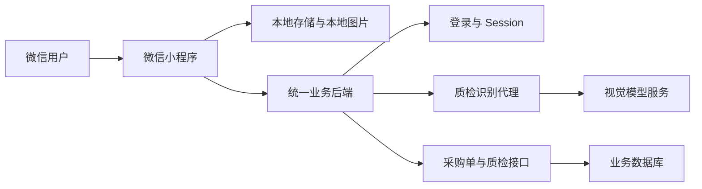

# README Regeneration Implementation Plan

> **For agentic workers:** REQUIRED SUB-SKILL: Use superpowers:subagent-driven-development (recommended) or superpowers:executing-plans to implement this plan task-by-task. Steps use checkbox (`- [ ]`) syntax for tracking.

**Goal:** Replace the obsolete README with a complete Chinese developer guide that matches the current authenticated recognition, review, task, history, and synchronization architecture.

**Architecture:** Treat current source files and tests as the documentation source of truth. Add a lightweight README contract test for stable capabilities and prohibited legacy instructions, then replace `README.md` with a single self-contained guide containing an architecture diagram, setup, APIs, storage, testing, troubleshooting, and release guidance.

**Tech Stack:** Markdown, Mermaid, TypeScript source-level tests, Node test runner through `tsx --test`.

## Global Constraints

- Document both `http://localhost:7875` and `https://www.binictools.cn:7876` as selectable backend examples.
- State that the active address is configured in `miniprogram/config/server.ts`.
- Do not describe direct model-gateway calls or client-side model tokens.
- Document Session Cookie authentication through `smartSalesSession:v1`.
- Document recognition queue maximum 10, local history maximum 30, and `inspectionHistory:v2` migration behavior.
- Do not modify application code, runtime configuration, package metadata, or existing unrelated working-tree changes.
- Do not add speculative roadmap items.

---

### Task 1: README Behavior Contract

**Files:**
- Create: `tests/readme.test.ts`

**Interfaces:**
- Consumes: repository-root `README.md`.
- Produces: stable positive and negative documentation assertions.

- [ ] **Step 1: Write the failing README contract test**

Create `tests/readme.test.ts`:

```ts
import test from 'node:test'
import strictAssert from 'node:assert/strict'
import { readFileSync } from 'node:fs'
import { resolve } from 'node:path'

const assert: typeof strictAssert = strictAssert
const readme = readFileSync(resolve(__dirname, '..', 'README.md'), 'utf8')

test('README documents the current authenticated inspection workflow', () => {
  const required = [
    'http://localhost:7875',
    'https://www.binictools.cn:7876',
    'smartSalesSession:v1',
    '最多 10 个未完成任务',
    'inspectionHistory:v2',
    '最多保存 30 条',
    'POST /api/miniprogram/quality-inspections/recognize',
    'POST /customer-orders/api/quality-inspections/standalone',
    'npm test',
    'npm run typecheck',
  ]
  required.forEach((value) => assert.match(readme, new RegExp(value.replace(/[.*+?^${}()|[\]\\]/g, '\\$&'))))
})

test('README removes obsolete direct-model and unsynchronized-client guidance', () => {
  assert.doesNotMatch(readme, /wx\.setStorageSync\(['"]llmApiToken/)
  assert.doesNotMatch(readme, /8865\/api\/llm\/v1\/chat\/completions/)
  assert.doesNotMatch(readme, /上传功能尚未实现/)
  assert.doesNotMatch(readme, /增加服务器端检验记录保存接口/)
})
```

- [ ] **Step 2: Run the focused test and verify RED**

Run:

```bash
npx tsx --test tests/readme.test.ts
```

Expected: the current README fails because it contains the direct `8865` endpoint and `llmApiToken` instructions and lacks the current Session Cookie, recognition queue, and standalone synchronization documentation.

- [ ] **Step 3: Commit the failing documentation contract only after the README task is GREEN**

Do not commit at RED. Keep the test modification for Task 2 so the final documentation and its contract are committed together.

---

### Task 2: Replace README with the Current Developer Guide

**Files:**
- Replace: `README.md`
- Test: `tests/readme.test.ts`

**Interfaces:**
- Consumes: current application configuration, services, domains, UI, and test behavior.
- Produces: a self-contained Chinese developer README.

- [ ] **Step 1: Replace the document with the approved structure**

Write `README.md` with these exact top-level sections and content requirements:

```markdown
# 智能质检报告微信小程序

面向工业检验报告的微信小程序客户端。小程序通过统一业务后端完成账号认证、图片识别、采购待检任务读取、独立报告创建、质检草稿保存和历史记录同步；客户端负责图片队列、结果校对、本地容错及 JSON 导出。

## 核心能力

- 账号登录和 Session Cookie 复用。
- 拍照或相册批量添加，最多 10 个未完成识别任务。
- 单队列顺序识别，识别期间仍可继续添加图片。
- JPEG/PNG 图片校验和 600 KB 上传限制。
- OCR 结果归一化为十样本检验表格。
- 置信度与确定性格式检查结合的红色/黄色审核提示。
- 采购待检任务选择、信息预填和草稿回写。
- 独立报告幂等创建及数据库同步。
- 本地和服务器历史记录合并、编辑及失败重试。
- `inspection-table/v1` JSON 文件导出和微信文件分享。

## 页面与业务流程

Describe login, scan queue, review, pending tasks, and history workflows in numbered lists.

## 系统架构

Include this Mermaid diagram:



Explicitly state that the client stores no model API key and never calls the model gateway directly.

## 技术栈

List WeChat Mini Program, TypeScript 5.5, WXML, SCSS, glass-easel, Node test runner, and tsx.

## 项目结构

Show current domain, services, pages/login, pages/index, shared styles, tests, and docs directories with accurate responsibilities.

## 环境要求

State WeChat Developer Tools, Node.js 18+ recommended, npm, and a running compatible shared backend.

## 安装

```bash
npm install
```

## 后端配置

Explain `miniprogram/config/server.ts` and show both alternatives:

```ts
export const SERVER_BASE_URL = 'http://localhost:7875'
```

```ts
export const SERVER_BASE_URL = 'https://www.binictools.cn:7876'
```

Explain that physical devices cannot use the development machine through their own `localhost`; use a reachable LAN/HTTPS address for device testing.

## 在微信开发者工具中运行

Provide import, `miniprogram/` root, AppID verification, legal-domain validation guidance for development, compile, and login steps.

## 认证与请求约定

Document storage key `smartSalesSession:v1`, automatic Cookie headers, 401 clearing and relaunch behavior, JSON envelope, 30-second request timeout, and 120-second upload timeout.

## 主要后端接口

Include a Markdown table for:

- POST `/api/miniprogram/auth/login`
- GET `/api/miniprogram/auth/me`
- POST `/api/miniprogram/auth/logout`
- POST `/api/miniprogram/quality-inspections/recognize`
- GET `/customer-orders/api/purchase-orders/quality-inspections`
- GET `/customer-orders/api/purchase-orders/quality-inspections/{taskId}`
- POST `/customer-orders/api/quality-inspections/standalone`
- POST `/customer-orders/api/purchase-orders/quality-inspections/{taskId}/items/{itemId}/draft`
- GET `/customer-orders/api/purchase-orders/quality-inspections/history-records`

Render each method and path together, for example `POST /api/miniprogram/quality-inspections/recognize`, so the contract test can verify them.

## 识别队列与图片处理

Document maximum 10 unfinished items, sequential processing, camera versus album selection, compression qualities `70 -> 50 -> 35 -> 20`, 600 KB failure behavior, JPEG/PNG server acceptance, and confidence review.

## 质检任务与数据库同步

Describe purchase-order flow and standalone flow. Explain stable UUID `clientRecordId`, idempotent standalone creation, draft save, sync states `local`, `syncing`, `synced`, `failed`, retry, and `YYYY-MM-DD` normalization from dotted/slashed/Chinese date forms.

## 本地记录与服务器历史

Document `inspectionHistory:v2`, migration from `inspectionHistory:v1`, maximum 30 records, saved image cleanup, remote/local merge, and the fact that deleting a local copy does not delete an already-synchronized server record. Include the exact phrase “最多保存 30 条”.

## JSON 导出

Document `inspection-table/v1`, UTF-8 JSON generation, filename form, excluded internal fields, `shareFileMessage`, and one retry after 150 ms.

## 测试与类型检查

```bash
npm test
npm run typecheck
```

Explain test coverage categories without hard-coding a test count.

## 常见问题

Cover 401, 403, 409, 413/600 KB, 422/date format, timeout/network, physical-device localhost, and legal-domain/HTTPS errors.

## 正式发布检查

Cover HTTPS and WeChat domain allowlists, backend credential ownership, permission controls, production base URL, real-device auth/upload/sync verification, and removal of development-only domain validation bypasses.
```

Replace the explanatory English sentences in this plan block with polished Chinese prose; do not leave planning instructions in the README.

- [ ] **Step 2: Check internal references and obsolete text**

Run:

```bash
rg -n "8865|llmApiToken|上传功能尚未实现|增加服务器端检验记录保存接口|inspectionHistory:v1" README.md
```

Expected: the only `inspectionHistory:v1` occurrence is the documented migration source. All other obsolete patterns produce no matches.

- [ ] **Step 3: Run the focused README test and verify GREEN**

Run:

```bash
npx tsx --test tests/readme.test.ts
```

Expected: both README contract tests pass.

- [ ] **Step 4: Run complete verification**

Run:

```bash
npm test
npm run typecheck
git diff --check
```

Expected: all tests pass, TypeScript exits with code 0, and no whitespace errors are reported.

- [ ] **Step 5: Review the final documentation diff**

Run:

```bash
git diff -- README.md tests/readme.test.ts
```

Confirm that only the README and its contract test are part of the implementation change and that no credentials or session values appear.

- [ ] **Step 6: Commit the regenerated README**

```bash
git add README.md tests/readme.test.ts
git commit -m "docs: regenerate developer README"
```
